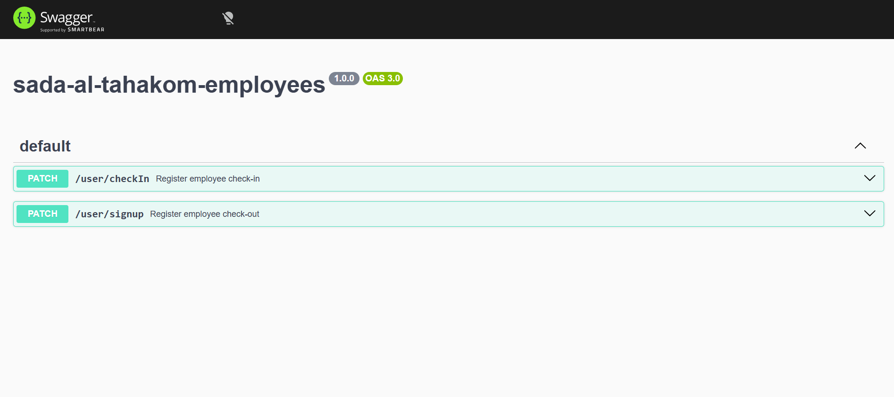
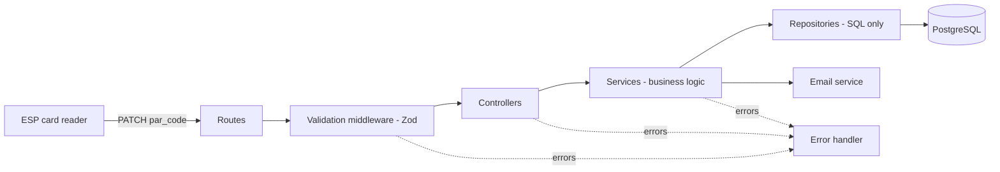
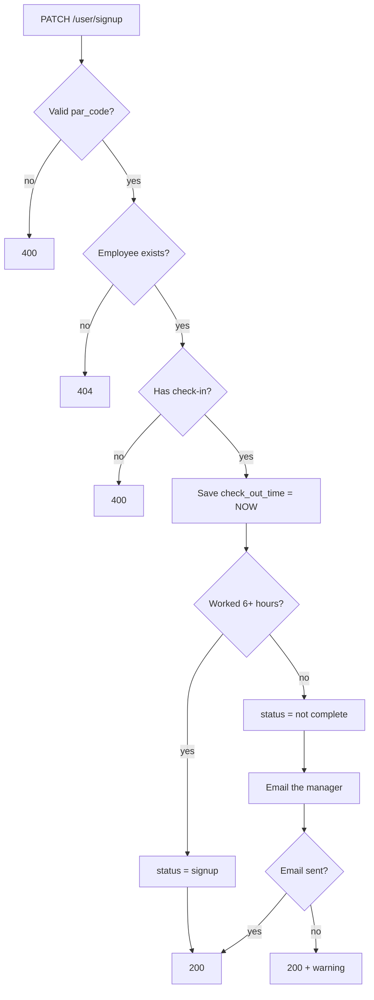

# Sada Al-Tahakom Employees: Attendance API

A REST API for an employee check-in / check-out system. An ESP-based card reader sends the employee's card code (`par_code`) to the server whenever a card is scanned. The server records the time, calculates the hours worked, and alerts the manager by email if an employee leaves before completing 6 hours.

## Features

- **Check-in / Check-out** by card code (`par_code`)
- **Server-side timestamps** using PostgreSQL `NOW()`, so the device never needs a reliable clock and nobody can send a fake time
- **Work-hours calculation** (correct even across midnight)
- **Automatic status**: `signup` (6+ hours) or `not complete` (less than 6 hours)
- **Manager email alert** when an employee works less than 6 hours. If the email fails, the check-out is still saved and the response includes a warning
- **Input validation** with Zod
- **Centralized error handling** with custom `AppError`
- **Structured logging** with Winston (JSON, error and combined log files) and request logging with Morgan
- **Interactive API docs** with Swagger UI
- **Automated tests** with Jest and Supertest (unit tests with mocks and HTTP integration tests)

## Tech Stack

| Area | Tools |
|---|---|
| Runtime / Framework | Node.js, Express |
| Database | PostgreSQL (`pg`, raw SQL) |
| Validation | Zod |
| Logging | Winston, Morgan |
| Email | Nodemailer (Gmail) |
| Testing | Jest, Supertest |
| Docs | Swagger UI (OpenAPI 3) |

## API Endpoints

Interactive documentation is available at **`/api-docs`** once the server is running.



| Method | Endpoint | Body | Description |
|---|---|---|---|
| PATCH | `/user/checkIn` | `{ "par_code": "1234" }` | Register check-in |
| PATCH | `/user/signup` | `{ "par_code": "1234" }` | Register check-out and calculate hours |

### Responses

| Status | Meaning |
|---|---|
| 200 | Success |
| 400 | Invalid `par_code`, or employee has no check-in |
| 404 | `par_code` not found |
| 500 | Unexpected server error |

**Check-out success example**

```json
{
  "user": {
    "id": 1,
    "name": "Ahmad",
    "par_code": "1234",
    "check_in_time": "2026-11-13T08:00:00.000Z",
    "check_out_time": "2026-11-13T15:00:00.000Z",
    "status": "signup"
  },
  "hours": 7,
  "minutes": 0
}
```

If the employee worked less than 6 hours, the response also contains `emailSent` (`true` or `false`) and, when the email fails, a `warning` message.

## Architecture

The project follows a layered architecture. Each layer has one responsibility.



| Layer | Responsibility |
|---|---|
| `routes/` | URL definitions only |
| `Middleware/` | Request validation and the global error handler |
| `controllers/` | Read the request, call the service, send the response |
| `services/` | Business rules (hours calculation, status, email decision) |
| `repositories/` | SQL queries only |
| `utils/` | Logger and the `AppError` class |

### Check-out flow



## Project Structure

```
.
├── app.js                  # Express app (middleware + routes), no listen()
├── server.js               # Starts the server and connects to the DB
├── config/connectionDB.js  # PostgreSQL connection
├── routes/users.js
├── controllers/userController.js
├── services/userService.js
├── repositories/userRepository.js
├── schemas/userSchemas.js  # Zod schemas
├── Middleware/
│   ├── validate.js
│   └── errorHandler.js
├── utils/
│   ├── AppError.js
│   └── logger.js
├── docs/
│   ├── openapi.js          # Swagger / OpenAPI definition
│   └── images/swagger.png
├── emailService.js
├── tests/
└── query.sql               # Database schema
```

`app.js` and `server.js` are separate so tests can import the app without opening a port or connecting to the database.

## Installation

### Prerequisites

- Node.js 18+
- PostgreSQL

### Setup

```bash
git clone https://github.com/tharaaalhaj/sada-al-tahakom-employees.git
cd sada-al-tahakom-employees
npm install
```

### Database

Create a database named `sada-al-tahakom-employees`, then run the SQL in `query.sql`:

```sql
CREATE TABLE users (
    id SERIAL PRIMARY KEY,
    name VARCHAR(250) NOT NULL,
    par_code VARCHAR(255) NOT NULL UNIQUE,
    check_in_time TIMESTAMP,
    check_out_time TIMESTAMP,
    status VARCHAR(20) DEFAULT 'entry only'
);
```

`par_code` is `UNIQUE`, so PostgreSQL automatically creates an index for it and lookups by card code are fast.

### Environment variables

Create a `.env` file in the project root (see `.env.example`):

```env
PASSWORD_DB=your_postgres_password
EMAIL_USER=your_gmail_address
EMAIL_PASSWORD=your_gmail_app_password
MANAGER_EMAIL=manager_email_address
```

For Gmail, use an [App Password](https://support.google.com/accounts/answer/185833), not your normal password.

## Run

```bash
npm run dev
```

The server starts on `http://localhost:3000`, and the API docs are at `http://localhost:3000/api-docs`.

## Testing

```bash
npm test -- --verbose
```

The tests cover:

- Validation errors (missing or invalid `par_code`)
- Employee not found (404) and no check-in (400)
- Check-out with more than 6 hours, exactly 6 hours, and less than 6 hours
- Manager email sent, and email failure (the check-out is still saved)

The database and the email service are mocked, so the tests run without a real database and never send real emails.

## Logging

Logs are written as JSON to the console and to the `logs/` folder (`error.log` and `combined.log`). Every HTTP request is logged, and unexpected errors are logged with their stack trace.

## License

MIT
